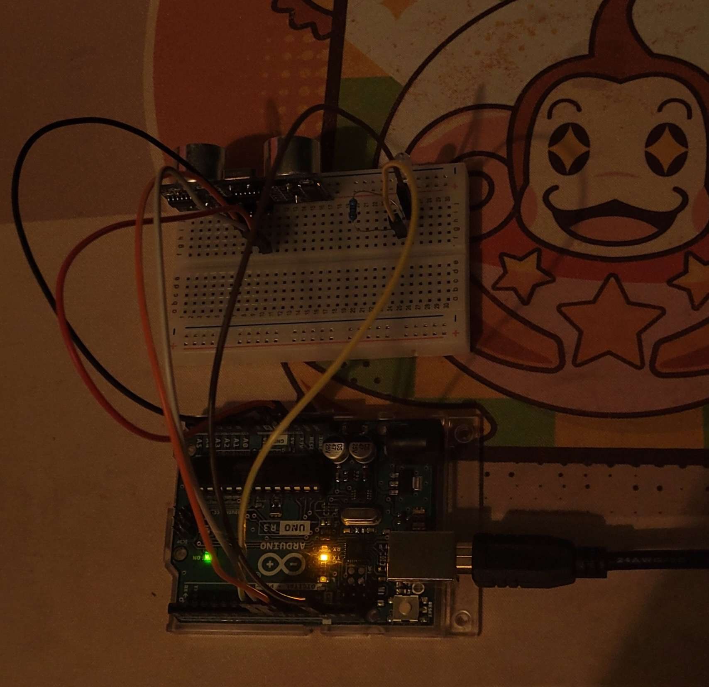
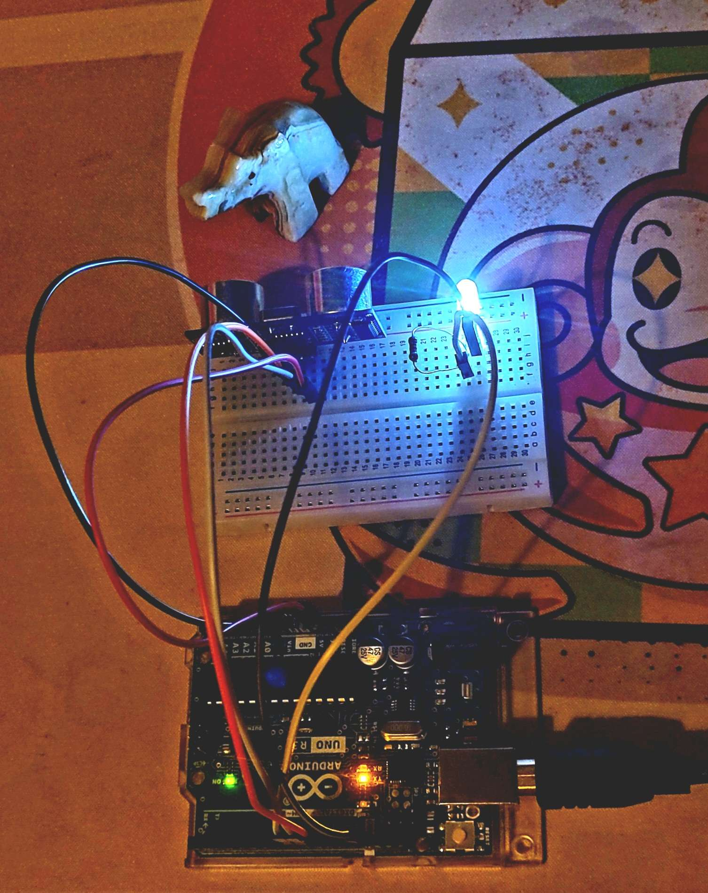
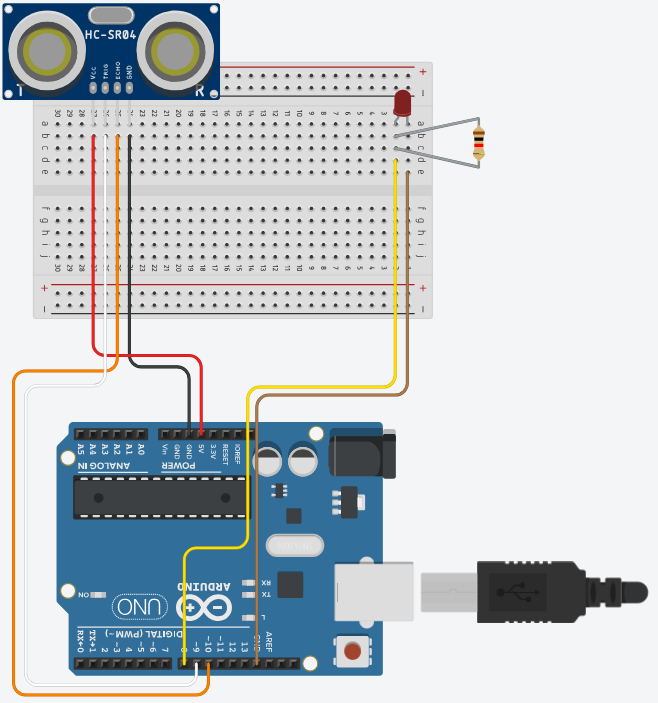

# 🧪 Experiment 1 - HC-SR04 Ultrasonic Sensor Test
## 📝 Description

In this experiment I was testing the HC-SR04 Ultrasonic Sensor. The goal of this experiment was to test and understand the functionality of the sensor by measuring the distance and using an LED as a visual alert when an object is detected within a certain range. This experiment is part of the final project, as I plan to use the sensor to do certain actions such as wake up the display, play a sound or show a greeting animation.

  
   

### 🎥 Experiment videos
[Link to the experiment video](/experiments/experiment-1-HC-SR04-Sensor-Test/media/USS-Experiment-Video.mp4)

## ⚙️ Technical Information
### 🔩 Components Used
- **Arduino Uno R3**
- **Jumper Cables**
- **Breadboard**
- **HC-SR04 Ultrasonic Sensor**
- **1 LED**
- **Approximately 10Ω Resistor**

### 💻 Code
[Link to the code page](/experiments/experiment-1-HC-SR04-Sensor-Test/UltraSonicSensorTestCode/UltraSonicSensorTestCode.ino)

The code is very simple. It uses the ultrasonic sensor to detect if an object is within 10cm distance and if it is, the LED lights up. It sends a trigger signal from trigPin, measures the echo response on echoPin and calculates the distance in cm. The distance measured is also printed out to the Serial Monitor.

### ⚡ Circuit Diagram
The wiring is quite simple and very straight forward. All of the components were put on the breadboard to make it easier to experiment and see how the circuit works. Below is the wiring necessary to make the sensor work as well as allow the led to be lit when the sensor is triggered. Any digital pin will work, but the code will need to be adjusted.

**Ultrasonic Sensor Wiring**
- VCC -> 5v
- GND -> GND
- TRIG -> Digital pin 9
- ECHO -> Digital pin 10

**LED wiring**
- Anode (the longer leg) -> ~10Ω resister -> Digital Pin 8
- Cathode (the shorter leg) -> GND pin

## 🔍 Observations & Challenges
I was very confused at first when trying to wire the sensor because my model (HC-SR04) had 4 pins while the documentation I was looking at had a different model (SEN136B5B) which only had 3 legs. I thought I bought a completely wrong thing but it I realised that these are just different models of the same component.

At first, I didn't use the resistor for the LED because I wanted it to be bright, which caused the LED to burn and stink up the room. I didn't realise how much power the LED can draw without the resistor. A 10Ω resistor was just enough to not burn the LED and to keep it bright.

## 📈 Evaluation
This experiment, although simple, was very insightful and fun. It taught me the importance of using resistors, which leads to the need to calculate and manage the power usage of the components. The experiment could further be improved by combining multiple hardware components, for example, displaying the distance measured directly to the LCD screen. Different coloured LEDS could be lit up depending on the distance, for example, if the distance is 30cm, then the red light turns on, if the distance is 10cm, then the green LED turns on. This experiment is useful to the final project because it will allow me to have the sensor detect a hand motion or someone approaching the Desk Assistant to then play a sound, display the time, or even do a cool greeting animation.