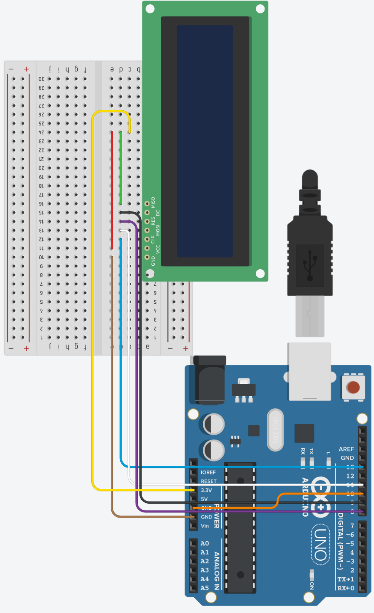
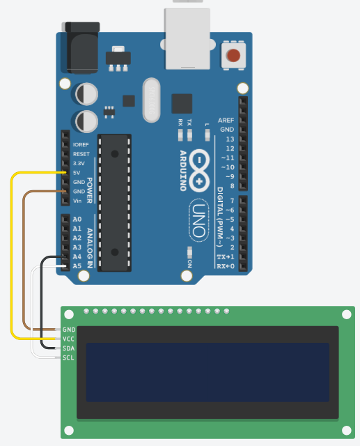
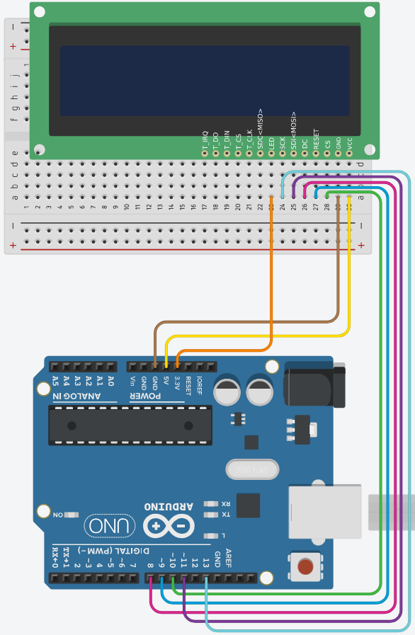

# 🧪 Experiment 2 - 3 Displays Test
## 📝 Description
This experiment initially was meant to be a comparison between the three displays I got, but turned into a troubleshooting nightmare. The three displays are: DollaTek 2.4-inch TFT SPI LCD (ILI9341) display, AZDelivery I2C 0.96-inch OLED display, and Hailege 2.8-inch ILI9341 TFT LCD Touch Display. After testing all three of the displays, only the small AZDelivery OLED Display was working, while the other two displays were showing white screens. The displays were tested individually, one after another.

## ⚙️ Technical Information
### 🔩 Components Used
- **Arduino Uno R3**
- **Jumper Cables**
- **Breadboard**
- **DollaTek 2.4" ILI9341 TFT LCD Display**
- **AZDelivery 0.96-inch OLED Display**
- **Hailege 2.8" ILI9341 TFT LCD Touch Display**

### 💻 Code
[Link to the DollaTek Display Code](/experiments/experiment-2-Display%20Tests/code/DollaTekDisplay.ino)

[Link to the AZDelivery Display Code](/experiments/experiment-2-Display%20Tests/code/AZDeliveryDisplay.ino)

[Link to the Hailege Display Code](/experiments/experiment-2-Display%20Tests/code/HailegeDisplay.ino)

Each display was tested using simple code to initialise the display and print out a text message. The DollaTek and Hailege displays were tested using the Adafruit_ILI9341 library, but both only showed a white screen. I also ran the official `graphicstest` sketch to see if that would work, but with no success. The AZDelivery OLED display used the Adafruit_SSD1306 library over I2C and has worked flawlessly. This confirmed the AZDelivery display to be functional, while the other two likely had compatibility issues.

### ⚡ Circuit Diagram
The DollaTek and the Hailege displays are both ILI9341 TFT LCD models, so they had similar wiring. The AZDelivery display uses I2C communication and with only four pins to connect. For the Hailege display, I didn't connect the touch display pins as I wanted to first test if the display can even output any text before doing the touch display test. The AZDelivery display was connected to the analogue pins (A5, A4) because it uses I2C communication, which is hardwired to the analogue pins.

**DollaTek Display Wiring**
- GND -> GND
- VCC -> 3.3v pin (this display was said to not be compatible with 5v on Amazon)
- CLK -> Digital Pin 13
- MOSI -> Digital Pin 11
- RES -> Digital Pin 8
- DC -> Digital Pin 9
- Miso -> 3.3v

**AZDelivery Display Wiring**
- GND -> GND
- VCC -> 5v pin
- SDA -> A4
- SCL -> A5 

**Hailege Display Wiring**
- VCC -> 5v pin (On Amazon this display **was** said to be compatible with 5v)
- GND -> GND
- CS -> Digital Pin 10
- RESET -> Digital Pin 9
- DC -> Digital Pin 8
- SDI(MOSI) -> Digital Pin 11
- SCK -> Digital Pin 13
- LED -> 3.3v pin

SDOC(MISO) and all the touch pins were left unconnected as they weren't necessary to simply display something.

## 🔍 Observations & Challenges
The biggest challenge was that only the AZDelivery display was working, the other two just showed a white screen. I really hoped to use a bigger display since it's more fitting for a desktop clock instead of a tiny one.

At first, I thought that I messed up the wiring, or the code was wrong, and I spent nearly a whole day looking at documentation and possible solutions to get them to work with no success. I tried different libraries like Adafruit and TFT_eSPI, swapped the DC and RESET pins, changed the SPI speed, and tested an example "graphicstest" sketch, but the displays remained completely unresponsive, showing only a white screen.

The most likely explanations I have as to why these displays weren't working, is that they may not have been genuine ILI9341 displays and were likely incompatible with the libraries I used. However, when buying the Hailege display, I saw a review with an image where a person had it working, but they were using a Raspberry Pi.

    
    
    

## 📈 Evaluation
The initial purpose of this experiment was to test the different displays to see which one would be more suitable for the final project, but that goal was only partially successful, as only one of the displays actually worked. While the other two larger displays failed to function despite extensive troubleshooting, the AZDelivery display worked immediately and reliably. Although it's not ideal for the final project due to its very small size, I will continue to use it throughout the development because it's the only one that has proven to be reliable.

The time spent troubleshooting gave me a deeper understanding of SPI and I2C communication, the importance of correct voltage levels, and how to recognise potential compatibility issues between hardware and libraries. I also learnt that some displays can sometimes be falsely advertised.

In future, I will be more cautious when buying Arduino components and will prioritise those with clear documentation, required compatibility, and more reviews. For now, I will proceed with the smaller OLED display, knowing that it's stable and simply works without any headache.
