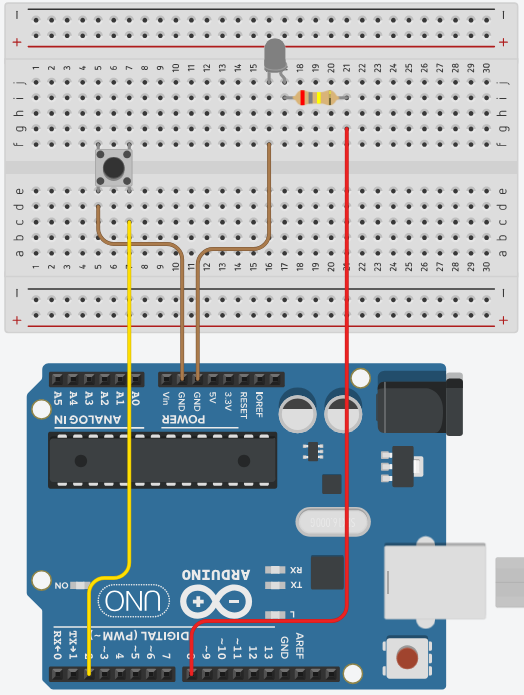

# 🧪 Experiment 3 - LED Toggle and Button Debounce Issues
## 📝 Description
This experiment focused on understanding what the debounce issue is and finding a reliable way to deal with it. A simple toggleable LED circuit was used to see how the physical button noise affects software behaviour. I tested three apporaches: starting with no debounce solution at all, then a very simple delay-based method, and finally using the Bounce2 library to handle the input cleanly.

### 🎥 Experiment videos

[Video with no debounce solution](/experiments/experiment-3-Button-Debounce-Test/media/LED%20Toggle%20DeBounce%20Issue.mp4)

[Video with a simple solution](/experiments/experiment-3-Button-Debounce-Test/media/LED%20Toggle%20DeBounce%20Issue%20simple%20solution.mp4)

[Video with the Bounce2 library](/experiments/experiment-3-Button-Debounce-Test/media/LED%20Toggle%20Working.mp4)

## ⚙️ Technical Information
### 🔩 Components Used
- **Arduino Uno R3**
- **1 Button**
- **1 LED**
- **1 220Ω Resistor**
- **Jumper Cables**
- **Breadboard**

### 💻 Code
[Link to the code page](/experiments/experiment-3-Button-Debounce-Test/code/simpleButton.ino)

The code uses the Bounce2 library to detect clean button presses using `debouncer.fell()`. Each time a press is registered, a boolean `ledState` variable is toggled, and the LED is updated. This ensures the LED changes states once per press, with no debouncing issues when holding the button.

### ⚡ Circuit Diagram
The wiring was simple, only using two main components. A resistor was used to prevent the LED from burning out (as it had happened before), and the breadboard was used to make connecting everything quicker and easier.

**Button Wiring**
- One leg -> Digital Pin 2
- Another leg (on the same side) -> GND

**LED Wiring**
- Anode (long leg) -> 220Ω resistor -> Digital Pin 8
- Cathode (short leg) -> GND

## 🔍 Observations & Challenges
In the first version of the code, I didn't use any debouncing techniques because I wanted to observe the issue directly. The problem became apparent immediately. The LED behaved erratically. Somtimes it would only dim instead of toggling on or off, and other times it would toggle unexpectedly on release.

I then added a basic `delay(200)` method after each press. This removed the dimming issue and slightly helped with the release issue. However, the core issue was still there. The LED still toggled inconsistently, and the timing felt imprecise.

Finally, I installed the Bounce2 Library which completely solved the problem. The button press was clean, and the LED toggled exactly as expected (once per press), regardless of how long or lightly the button was pushed.

## 📈 Evaluation
This experiment was essential for me to understand how unreliable physical input can disrupt even the simplest interactions, like pressing a button. It clearly showed that button press issues aren’t just one-off glitches, but a persistent problem that can break basic functionality if not addressed properly. Using the Bounce2 library was the most effective and efficient fix, and I'll be using it in future experiments that involve buttons and the final project.