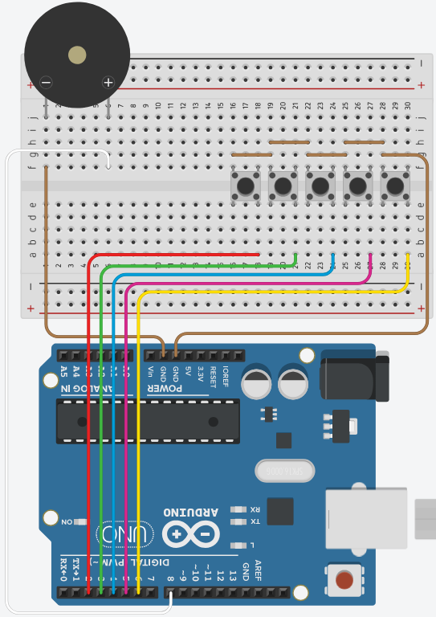

# 🧪 Experiment 5 - Buzzer Sounds
## 📝 Description
This experiment was about experimenting with the electronic buzzer component to see how it works and to find the most suitable sound frequency for the button presses. Whenever the user presses a button to switch between menus, I want a subtle beep sound, similar to a Tamagotchi.

### 🎥 Experiment videos
[Link to the experiment video](/experiments/experiment-5-Buzzer-Sounds/media/Sound%20Test.mp4)

## ⚙️ Technical Information
### 🔩 Components Used
- **Arduino Uno R3**
- **Jumper Cables**
- **Breadboard**
- **5 Buttons**
- **DC 3v Electronic Piezo Buzzer**

### 💻 Code
[Link to the code page](/experiments/experiment-5-Buzzer-Sounds/code/buzzer.ino)

The code for this experiment was also quite simple, only requiring to define and initialise the pins. Simple if statements were used to play a specific sound frequency depending on which button was pressed, followed by a function to play a sound frequency using `tone()` with a delay of 50 ms (0.05 seconds), pause before stopping the sound.

The Bounce2 library was not used in this experiment because the button interaction was very simple and button bounce had no noticeable effect. For future experiments involving more complex button interactions, Bounce2 will still be used for reliable input.

### ⚡ Circuit Diagram
The wiring for this experiment was simple. The piezo buzzer wiring is almost identical to an LED, with a short cathode leg connected to GND and a longer anode leg connected to a digital pin. Five buttons were wired to trigger different sounds from the same buzzer.

**Piezo Buzzer Wiring**
Cathode (Shorter Leg) -> GND Pin
Anode (Longer Leg) -> Digital Pin 8

**Buttons Wiring**
- One leg -> Digital Pins 2,3,4,5,6
- Another leg (on the same side) -> GND

## 🔍 Observations & Challenges
There were no major challenges experienced during this experiment, except for the fact that this piezo buzzer is quite limited in the sounds it can produce, being limited to only basic wave tones at different frequencies, which can sound a bit harsh or unpleasant depending on the pitch and duration.

At first, I hated the sounds it was making and considered getting a DFPlayer Mini MP3 module with a speaker, but that was before I tweaked the `delay()` function to 50 ms and realised that these were the exact Tamagotchi-like sounds I was looking for. I was also holding the buttons to hear the sounds, but then realised that you would not be needed to hold the buttons, as you would only quickly press them to switch menus.

My favourite frequencies were 1000 Hz and 1500 Hz, so in the final project, I will likely use one of these frequencies or maybe something in the middle, or perhaps I will have slightly different frequencies for different menus. This will be decided and fine tuned in the final project.

## 📈 Evaluation
This experiment helped me understand how to use a piezo buzzer to produce different sounds depending on which button was pressed. Although the buzzer is quite limited in the sounds it can produce, I was able to find a few frequencies that I believe will work well in the final project for a subtle button feedback.

Initially, I didn't like the sounds, but after adjusting the duration with `delay(50)`, I realised that the sounds resembled the kind of short beep I was initially looking for. I also realised that the buttons will be tapped briefly, not held down, which makes the sound feel more natural.

In the future project, I will try and experiment with a DFPlayer Mini MP3 module with a speaker to produce more complex sounds from an actual audio file.