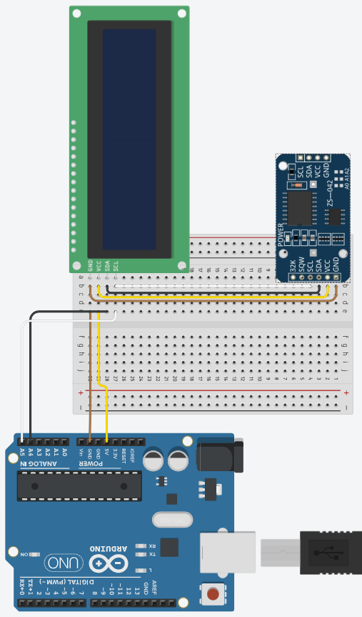

# 🧪 Experiment 6 - RTC Module Test
## 📝 Description
The purpose of this experiment was to test whether the RTC module was functioning correctly and could display the current date and time on an OLED display.

## ⚙️ Technical Information
### 🔩 Components Used
- **Arduino Uno R3**
- **Jumper Cables**
- **Breadboard**
- **DS3231 RTC Module**
- **AZDelivery OLED Display**

### 💻 Code
[Link to the code page](/experiments/experiment-6-RTC-Module/code/RTC.ino)

The code initialised the RTC module and the OLED display, then retrieved the current time and date using `rtc.now()` and displayed it on the screen. A delay was used to update the time every second. The `rtc.adjust()` was used to adjust the time to the correct one, and then commented out to prevent the RTC from being reset to the compile time whenever power was disconnected from the Arduino.

### ⚡ Circuit Diagram
The RTC module and the OLED display were both connected using I2C, sharing the same breadboard rows for all of their connections. They both use the I2C protocol, which on the Arduino Uno is hardwired to the analogue pins A4 (SDA) and A5 (SCL), allowing multiple devices to communicate over the same two pins. The 32K pin is used for synchronising external components, and the SQW pin is used to trigger something periodically, like an alarm, for example, thus they were left unconnected in this experiment as these weren't necessary.

**RTC Module + Display Wiring**
- GND -> GND
- VCC -> 5v
- SDA -> Analogue Pin 4 (A4)
- SCL -> Analogue Pin 5 (A5)

## 🔍 Observations & Challenges
There were no major issues during this experiment, and both the RTC module and the OLED display worked as expected. One point of interest was the use of `rtc.adjust()` to set the time. After testing, I observed that this line should only be used once to initialise the RTC with the correct time, then commented out to prevent resetting the clock to the compile every time I unplugged the Arduino. Once that line was removed, the RTC continued to keep accurate time even after power loss, thanks to the onboard battery. This confirmed that the module was working as expected. Another additional note worth mentioning is that the RTC was slightly behind real time, by about 2-4 seconds, but I believe that to be negligible and acceptable for the final project.

    
    

## 📈 Evaluation
This experiment successfully confirmed that the RTC module was working and able to track and display the current time and date reliably. It also helped to reinforce how I2C communication works and how multiple devices can share the same Arduino pins. Testing the `rtc.adjust()` function gave me a better understanding of how the RTC handles time and retention using its built-in battery. Overall, this was a simple yet important experiment, as accurate timekeeping will be important for the final project's clock functionality.