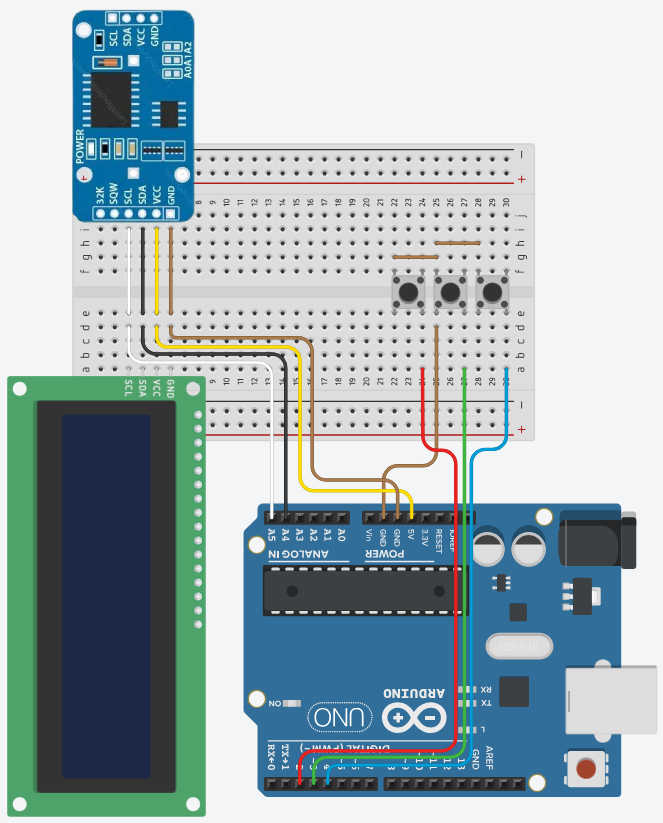

# 🧪 Experiment 7 - Stopwatch Menu Logic
## 📝 Description
The purpose of this experiment was to implement a stopwatch as one of the menus in the interface. The goal was to allow the user to start, pause, and reset the stopwatch, while also being able to navigate to other menus without the stopwatch resetting. While doing this, I also added the intended functionality to the first two menus, the clock and the date menus.

### 🎥 Experiment videos
[Link to the experiment video](/experiments/experiment-7-Stopwatch-Menu/media/StopwatchMenuVideo.mp4)

## ⚙️ Technical Information
### 🔩 Components Used
- **Arduino Uno R3**
- **Jumper Cables**
- **Breadboard**
- **DS3231 RTC Module**
- **AZDelivery OLED Display**
- **3 Buttons**

### 💻 Code
[Link to the code page](/experiments/experiment-7-Stopwatch-Menu/code/StopwatchMenu.ino)

The code is recycled from my previous Menus Test experiment, with the LED functionality removed as it wasn't needed, and with a new stopwatch functionality added to the third menu. The stopwatch can be started, paused, and reset using a single button, and it continues running even when the user switches to another menu. The time and date menus code was reused from experiment 6 - RTC Module, because it worked well and I didn't need to add anything extra.

### ⚡ Circuit Diagram
The wiring is very simple and uses all the previously tested components. The display and the RTC once again share the same I2C connections (A4 for SDA, A5 for SCL), which is possible because I2C supports multiple devices connected via the same pins. The 32K and SQW pins on the RTC were left unconnected as they weren't necessary. The buttons share the same Arduino GND pin and are connected to digital pins 2,3, and 4.

**RTC Module + Display Wiring**
- GND -> GND
- VCC -> 5v
- SDA -> Analogue Pin 4 (A4)
- SCL -> Analogue Pin 5 (A5)

**Buttons Wiring**
- One leg -> Digital Pins 2,3,4
- Another leg (on the same side) -> GND

## 🔍 Observations & Challenges
There were no hardware challenges experienced in this experiment, as the wiring and the components were already tested in earlier experiments. Most of the challenge came from implementing the stopwatch logic. One key part was making sure that the stopwatch would continue running even when the user switched to a different menu, without resetting the timer. This required separating the stopwatch logic from the display logic and managing when the stopwatch should start, stop, or reset.

Another small challenge was implementing the long press to reset the stopwatch. This involved tracking how long the button was held down without interfering with the normal menu switching behaviour. After some testing, a 2-second hold was chosen as it was a good balance between usability and accidental resets.

One small thing to note is that when you pause the stopwatch and then hold the button to reset it, the timer unpauses and continues to count during the 2-second hold period. This happens because the stopwatch continues to track time using `millis()` while the button is being held, and the reset is only triggered after the full 2-second hold is complete. Since this doesn't affect the reset functionality and the stopwatch behaves as expected, I chose to leave it as-is for now and may polish this minor issue later in the final project.

## 📈 Evaluation
This experiment successfully added a stopwatch feature to the existing menu system and added actual functionality to the clock and date menus, with them now being able to display time and date. I was able to integrate this time-based stopwatch logic cleanly into the previously developed code, without breaking the entire functionality. The stopwatch was able to start, pause, and reset using a single button, and it continued running correctly in the background even when switching to another menu. Implementing the reset also added a small but important interaction improvement without requiring a separate button.

This experiment was important in testing how persistent state and real-time logic can be managed in a multi-screen interface, which will be very important in the final project. Overall, the outcome was reliable, and the code structure remains flexible for future additions.