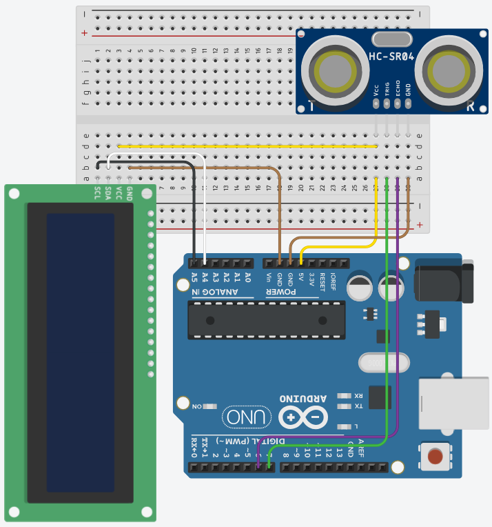

# 🧪 Experiment 8 - Ambient Mode
## 📝 Description
The purpose of this experiment was to test if I could effectively implement a low-power state, or an ambient mode, which would turn off the display after a period of inactivity to preserve battery. Using an ultrasonic sensor, the user can then wave their hand in front of it to wake the screen up.

### 🎥 Experiment videos
[Link to the experiment video](/experiments/experiment-8-Ambient-Mode/media/ambientModeVideo.mp4)

## ⚙️ Technical Information
### 🔩 Components Used
- **Arduino Uno R3**
- **Jumper Cables**
- **Breadboard**
- **AZDelivery OLED Display**
- **HC-SR04 Ultrasonic Sensor**

### 💻 Code
[Link to the code page](/experiments/experiment-8-Ambient-Mode/code/ambientMode.ino)

The code uses the `millis()` function to track the time since the last user interaction. If the sensor detects an object within 5cm, the display turns on and shows a message. While the display is on, `miilis()` is repeatedly checked, and once 5 seconds have passed without the sensor detecting anything, the screen is cleared to simulate a low-power state or an ambient mode. This is done without using `delay()` for timing, to make sure that the program stays responsive and continues checking for hand proximity in the background.

### ⚡ Circuit Diagram
The wiring is very straightforward, with the OLED display and the ultrasonic sensor connected to the Arduino using the same I2C and digital pin principles used in previous experiments. The display and sensor operate independently but work together in the logic to trigger and display the ambient mode behaviour.

**Display Wiring**
- GND -> GND
- VCC -> 5v
- SDA -> Analogue Pin 4 (A4)
- SCL -> Analogue Pin 5 (A5)

**Ultrasonic Sensor Wiring**
- GND -> GND
- VCC -> 5v
- TRIG -> Digital pin 6
- ECHO -> Digital pin 7

## 🔍 Observations & Challenges
There were no wiring or hardware issues in this experiment, as the display and the ultrasonic sensor had already been tested in earlier experiments. The main focus was on the logic behind detecting inactivity and triggering a simulated low-power state. Using `millis()` instead of `delay()` allowed the program to stay responsive while tracking time accurately in the background. One minor challenge was finding a suitable trigger distance to reliably detect a hand wave without false positives. In the end, a 5cm distance was the best option, but it may increase to 10cm in the final project. Another thing to note is that in this experiment, the screen turns off after 5 seconds just for demonstrative purposes in the video. In the final project, this will be increased to possibly 5 minutes, with the potential to be customisable in the future.

## 📈 Evaluation
This experiment successfully demonstrated a basic ambient mode system, where the display turns off after a period of inactivity and can then be reactivated by motion using an ultrasonic sensor. The use of `millis()` to track elapsed time allowed the system to remain responsive and accurate without blocking other processes. While the timing and trigger distance were adjusted for demonstration purposes, the experiment confirmed that this logic can be reliably integrated into the final project. It also provides a clear foundation for future improvements, like simply adjusting when and how the screen turns off, as well as adding more minor features like an LED blinking slowly while in this ambient mode, as an example.