#   🚀 Final Project - Desktop Clock

##  🧠 Initial Concept
### 💡 Project Idea and Inspiration
After watching Rick and Morty as a teenager, I became fascinated by the "Pass me the Butter" robot. That idea, combined with the concept of SCP-079 (a sentient computer from the fictional SCP Foundation), sparked a long-term interest in creating a somewhat sentient and a small task-focused AI robot. With today's accessibility and the power of AI, creating something like this seems very much possible.

However, I quickly realised that creating a fully functioning AI robot is far too ambitious given the limited timeframe and my current experience level with Arduino. Even a partially functional version would likely become an unmanageable time sink.

Instead, I decided to pursue a scaled-down but conceptually similar project. A multifunctional desktop clock. At its core, this will be a digital clock with a small display and menu navigation via buttons. Planned menus include time, date, stopwatch, and timer functions. When looking at projects that people have created, I really liked the ultrasonic sensor in projects such as the [Obstacle Avoiding Robot](https://www.youtube.com/watch?v=jQwYBc7YBXs) and the [Parking Sensor](https://www.youtube.com/watch?v=sEWw087KOj0), so I wanted to include this component to create a low-power or an ambient mode that preserves battery life. When the user waves their hand in front of the clock, it wakes up and displays the information.

This refocus allows me to build a creative and technically layered project while staying within the scope. This also lays the foundation from which I can build on in the future when I will be revisiting the initial idea.

**What the final result might look like. [Link to this clock on Amazon.](https://www.amazon.co.uk/Digital-Display-Temperature-Backlit-Brightness/dp/B09JTV61YC)**

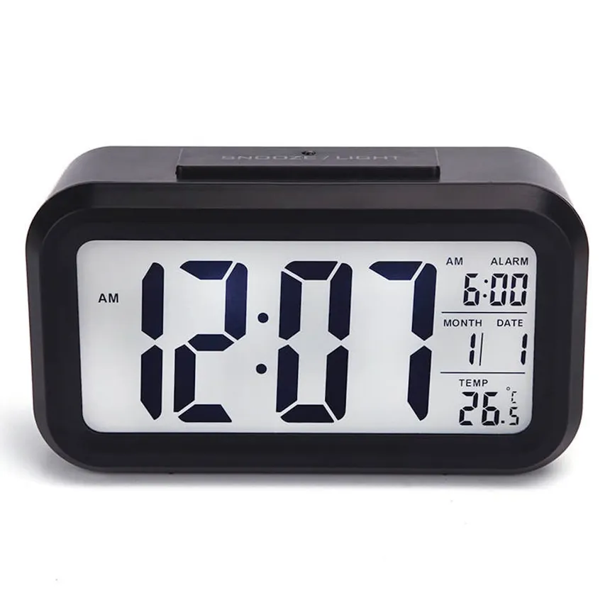

### 🎯 Target audience
The primary target audience for this project is me. As I mentioned earlier, this will lay a foundation for my initial idea in the future as well as being a distraction-free alternative to checking my phone all the time for time, which is quite distracting when focusing on something.

This project is also suitable for beginner Arduino enthusiasts who are looking for a first project. It serves as a practical and manageable base to explore buttons, displays, sensors and user interaction, without overwhelming complexity. Enthusiasts could also adapt or build on the project to better suit their specific needs.

While not intended as a commercial product, this project could be seen as an early prototype for a minimalist desk smart clock. With additional functionality and polishing, it has the potential to evolve and compete on the market.

### 🛠️ Planned Experiments
This project will be developed in stages, beginning with individual experiments testing and understanding each major component, such as the ultrasonic sensor, buttons, and the RTC module for time. These experiments will help shape the final build to ensure that each component works reliably. These separate experiments will then be integrated together and polished into a complete final project.

### 🚧 Expected Challenges
One expected challenge I found out about when researching is handling button debounce, which can cause the Arduino to register multiple presses from a single input. I understand this issue in theory, but I will have to figure out how to manage this in code.

Power management is another big consideration, as I have already burnt some LEDs when experimenting. I estimated the power usage and it's well below the Arduino's current limit. I'll still need to ensure that components like LEDs and the screen are properly regulated with resistors and capacitors.

Implementing multiple display menus may also be tricky, as it involves managing input, display updates, and state transitions. I expect this to be one of the most technically demanding aspects.

Lastly, I will need to keep an eye on the memory usage as the Arduino Uno has limited space, and if I use too many libraries, there could be issues.

# 🕰️ Final Project
## 📝 Overview
This final project brings together all of the experiments and design work into a complete, functional desktop clock. It features three interactive menus (time, date, and stopwatch), physical buttons for navigation, visual feedback via LEDs, and a piezo buzzer for audio. An ultrasonic sensor is used to trigger an ambient mode, putting the screen to sleep after 5 seconds of inactivity and waking it when motion is detected. The final design also includes a 3D-printed enclosure to give the device a more polished and standalone appearance.

    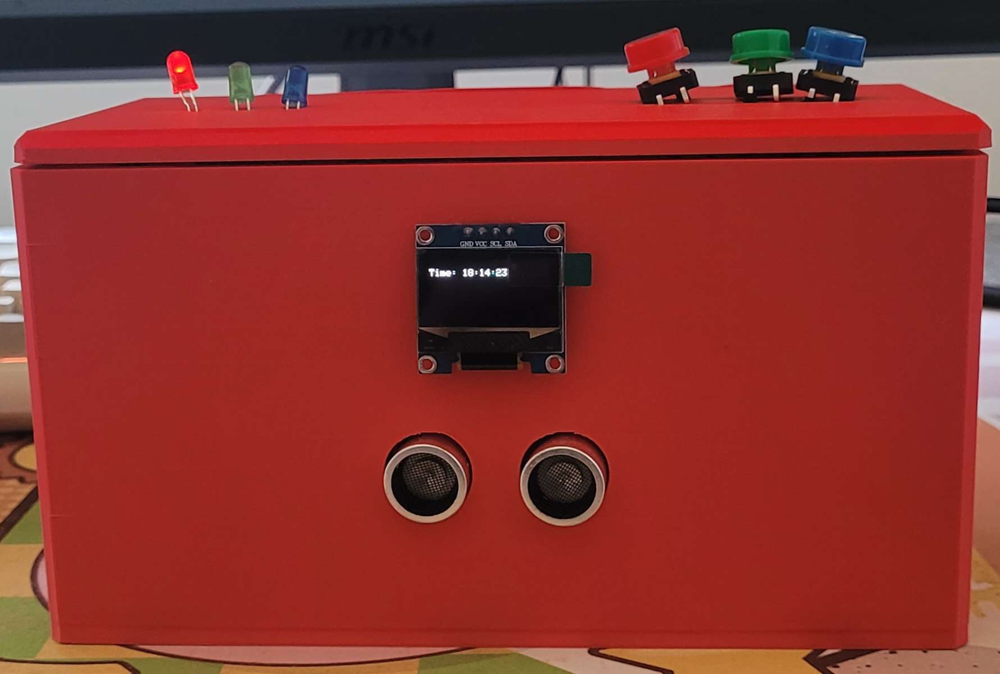

### 🎥 Experiment video
[Link to the experiment video](/final-project/media/finaVideo.mp4)

##  ⚙️ Technical Information
### 🔩 Components Used
- **Arduino Uno R3**
The "brain" of the project, running the code to handle all the hardware components

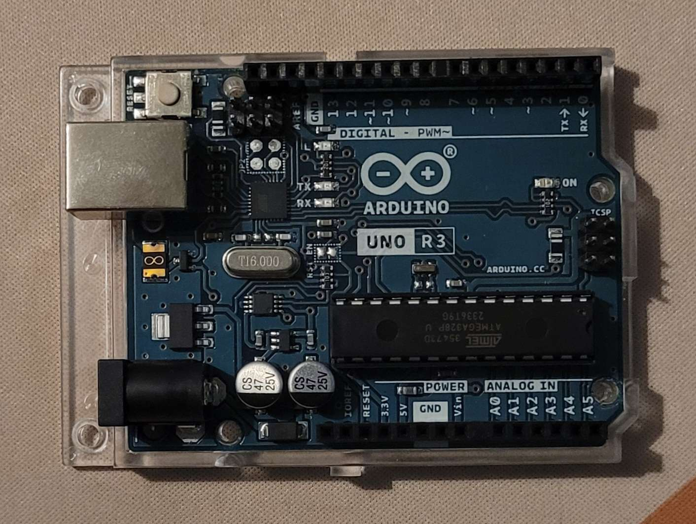

- **DS3231 RTC Module**
Keeps accurate time and date information, even without power due to its built-in battery

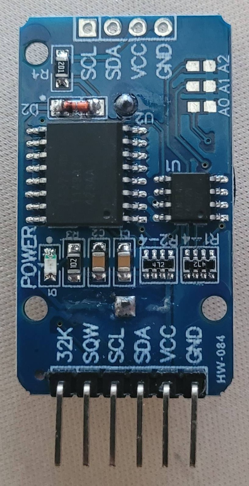

- **0.96" I²C OLED Display (SSD1306)**
Used to display time, date, and stopwatch menus

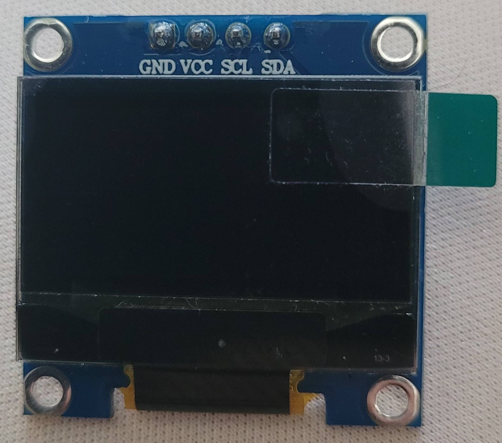

- **3 Tactile Push Buttons**
Used to navigate between the three menus

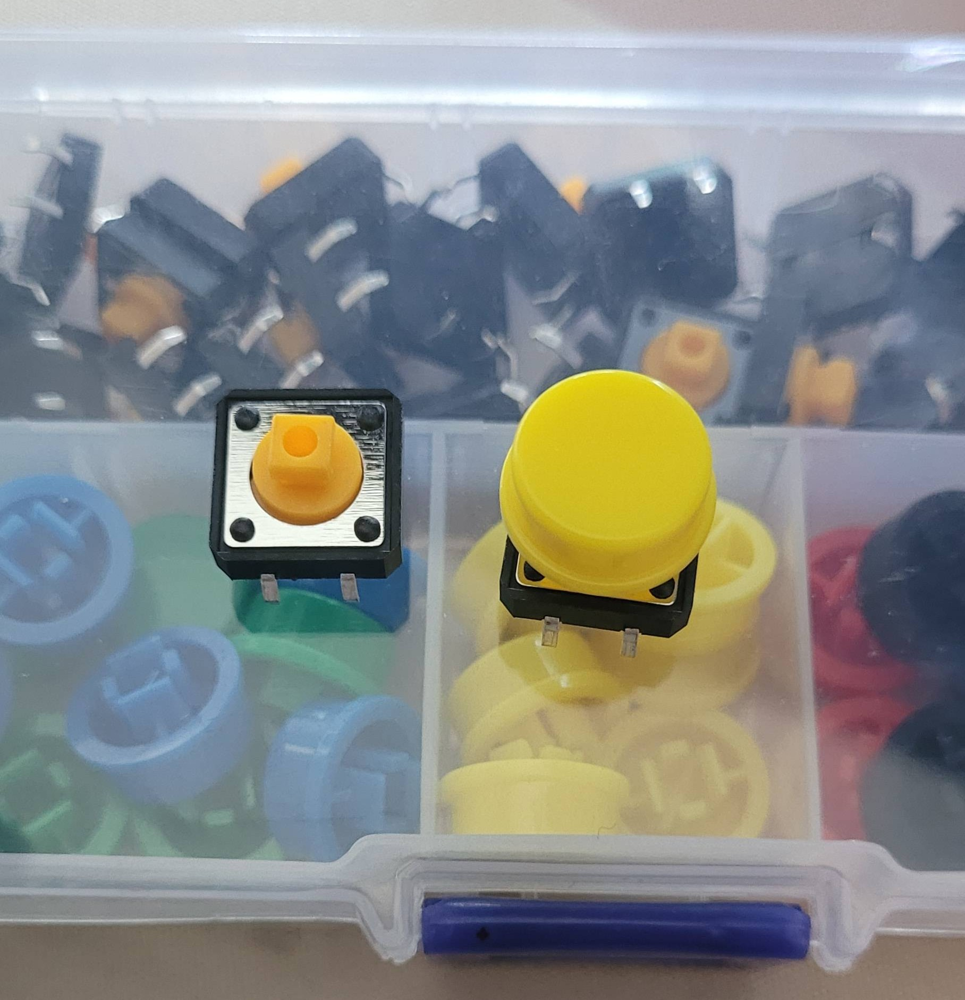

- **3 LEDs (Red, Green, Blue)**
Provide visual feedback for the currently active menu.

- **3 Resistors (6,800Ω for LEDs)**
Prevents the LEDs from burning out, and is used to slightly lower the brightness of them.

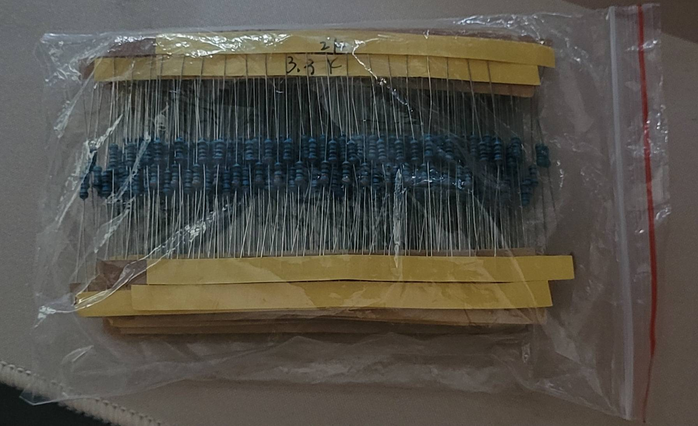

- **Piezo Buzzer**
Emits a short 1000 Hz beep every time a button is pressed to provide audio feedback

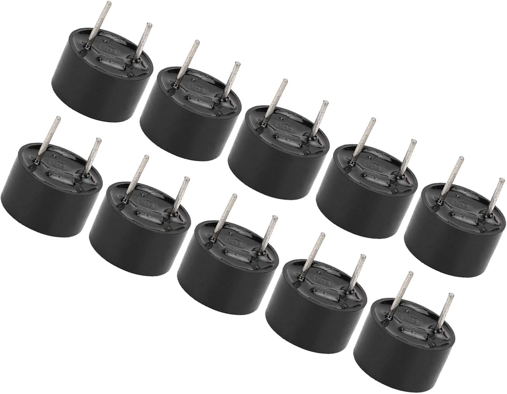

- **HC-SR04 Ultrasonic Sensor**
Detects motion in front of the display. If no motion or button press is detected for 5 seconds, the screen turns off to save power. Motion or button press wakes it.

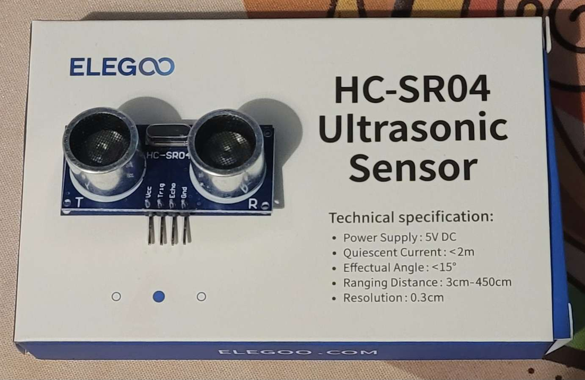

### 💻 Code
[Link to the code page](/final-project/code/final.ino)

The final code is pretty much a compilation of all the previous experiments and combines all major features into one structured program. It begins with global variables for pin assignments, menu state, stowatch timing, and screen sleep behaviour. Bounce2 is used to debounce all button inputs.

In the `setup()` function, all components are initialised and the starting menu is rendered. The `loop()` function handles input updates, menu switching, stopwatch control, and screen sleep/wake-up logic. Stowatch time is tracked using `millis()` with `unsigned long` variables, and a 2-second-long press to reset the time.

Menus are rendered using the `renderMenu()` function based on the `currentMenu` value. LEDs and audio feedback are handled on button presses. If no motion or button input is detected for 5 seconds, the screen is turned off using `ssd1306_command()`, and reactivated upon detecting an interaction.

The code is modular, with functions like `selectMenu()`, `playBeep()`, and `motionDetected()` to keep the structure clean and maintainable.

### ⚡ Circuit Diagram
The wiring was straightforward overall, but the number of connections made it a bit difficult to connect everything, especially when connecting the circuit inside the 3D-printed box, where space was limited. The RTC and the display both use I2C, so they were connected to the same SDA and SCL pins as done in previous experiments. Each LED was wired with a 6,800Ω resistor. This is a much higher value than in previous experiments because I didn't want the LEDs to be blindingly bright when used in a dark room or at night. All GND connections for the components were linked together and connected to a single Arduino GND pin.

**OLED Display Wiring**
- VCC -> 5V
- GND -> GND
- SDA -> A4
- SCL -> A5

**RTC Module Wiring**
- VCC -> 5V
- GND -> GND
- SDA -> A4
- SCL -> A5
- 32K and SQW -> Not connected

**Ultrasonic Sensor Wiring**
- VCC -> 5V
- GND -> GND
- TRIG -> Digital Pin 6
- ECHO -> Digital Pin 7

**LEDs Wiring**
- Anode -> 6,800Ω resistor -> Digital Pins 8,9,10 (Red, Green, Blue)
- Cathode -> GND

**Button Wiring**
- One leg -> Digital Pins 2,3,4 (Red, Green, Blue)
- Another leg (on the same side) -> GND

**Piezo Buzzer Wiring**
- Anode (long leg) -> Digital Pin 11
- Cathode (short leg) -> GND

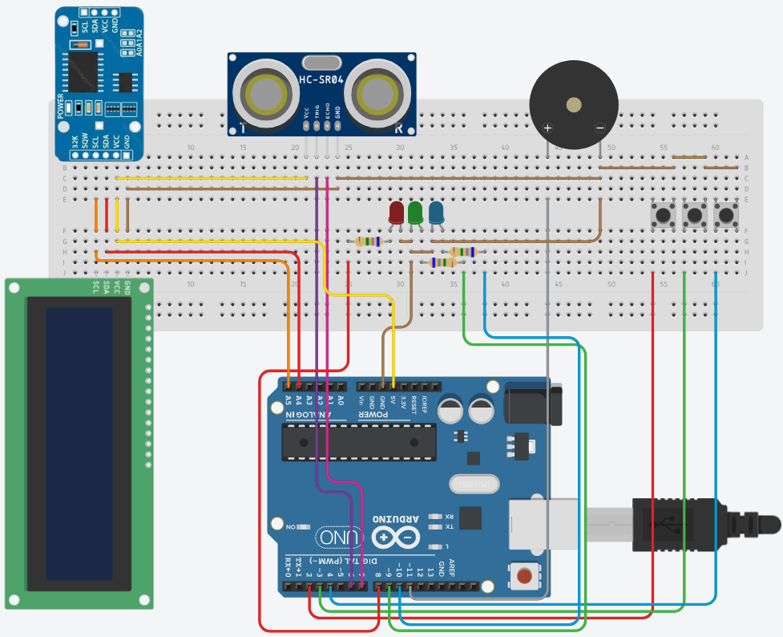

### 🖨️ 3D Printing Process
To make the final project feel more complete, I designed and 3D printed an enclosure to house the wiring and the components, making it look more like a functional desktop clock. The enclosure was modelled using [Fusion 360](https://www.autodesk.com/products/fusion-360/personal), based on measurements of the components. I made cut-outs and grooves to match the shapes and pin layouts of the display, sensor and LEDs. The enclosure was printed using a [Bambu Lab A1 Mini](https://bambulab.com/en-gb/a1-mini). You can find the .STL file [here](/final-project/3D%20Model%20Design/Mykyta's%20Box.stl).

The enclosure successfully hides the wiring and improves the presentation of the project. However, after installing all components, I realised I forgot to make a hole for the Arduino's USB power cable, so I had to drill it manually after the print. Up until this point, I haven't even considered powering the clock with a battery, which would have avoided the need for drilling and would make more sense for a self-contained desktop clock. The grooves for the components were a perfect fit, but some components sit loosely and stick out slightly. I wanted to glue them in place, but I didn't have any superglue in my house.

One design flaw was the way I modelled the button grooves. I used two parallel lines for the button pins, which don't hold the buttons securely and allow them to slide. I would have preferred four small holes (similar to the LED ones) to make the buttons more stable. The enclosure itself could also have been much smaller. I used a large breadboard to keep the wiring process simpler, but a smaller board would have reduced the overall size significantly.

In the future, I would also aim to tilt the front panel upwards, so that the screen and the sensor face the user more directly. This would both improve visibility of the display and usability of the sensor.

    
    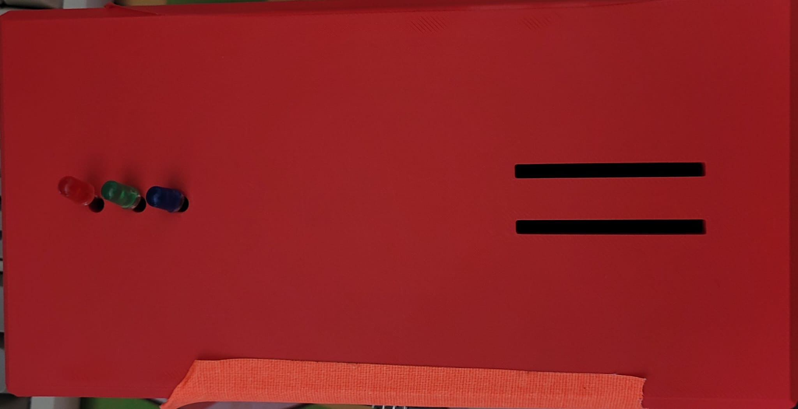

## 🔍 Observations & Challenges
One early issue I ran into was with the RTC module. Initially, I placed the `rtc.adjust()` line before `rtc.begin()` in the setup function, which caused the program to not even start with no display output and no button or LED response. Reordering the two lines of code so that the RTC is initialised first instantly fixed the issue. Button input was handled using the Bounce2 library, which worked reliably and as expected. Since I had experimented with this in an earlier experiment, there were no issues or necessary tweaks.

The screen sleep logic presented another small challenge. The screen wasn't turning off after 5 seconds as expected. This was due to the `lastInteractionTime` variable being continuously refreshed, even when no input was happening. After looking at the previous experiments, to see what I did wrong, I updated the code so that this value only changes when actual interaction or motion is detected, and the timeout started working as intended.

While the wiring itself wasn't difficult, it was a bit complex to implement due to the constraints of the 3D-printed enclosure. Limited space made wiring the components a bit of a hassle and awkward. I also forgot to include a hole cut-out for the power cable in the design, so I had to drill this hole myself. Despite these minor issues, everything worked out as intended in the end, and all of these issues were solved with small code adjustments or a bit of elbow grease.

## 📈 Final Evaluation
This project brought together everything I had learned throughout the experiments and turned it into a complete and functional desktop clock. I was able to implement everything I planned, such as multiple menus, button navigation, and an ambient mode. One thing which I had scrapped was the countdown timer because I realised that it would be far too difficult to implement and handle with only four buttons, but I'm happy with the overall end result.

One of the most valuable parts of this project was learning how to manage multiple components within a single program and structure the code to remain modular and maintainable. The use of I2C for the RTC and the display, input handling with the Bounce2 library, and real-time logic with `millis()` all came together in a way that felt cohesive. It also gave me a better understanding of state management and how to preserve behaviours like the stopwatch running in the background, even when navigating away from it.

Physically, the project came together well, and the 3D-printed enclosure gave it a finished, product-like feel. However, I would definitely spend more time iterating on the physical design if I were to do this again. A smaller size, better component grooves, and a more ergonomic front angle would all greatly improve the user experience.

There are other things I would polish or expand on in the future. A battery-powered option would make more sense for a standalone desktop clock. I would also improve the button groove design, as mentioned earlier, and add more subtle UX details like a starting animation or a screen when the display wakes up, and a slight pulsating LED when the display is in an ambient mode. Automatic brightness control would also be nice to implement using a photoresistor, so that the display can lower its brightness when it gets dark.

Overall, the project met my expectations and goals. It was technically successful, visually clean, and functionally complete. It gave me a solid foundation for expanding the project later, or even returning to my original AI robot concepts now that I have more experience.

## ⭐ Acknowledgements
A special thanks to my tutor, Antony Bowers, for the guidance throughout this project, and to my friend Ali Jamali, a Warwick Engineering student, who helped me with the 3D enclosure design and the printing process.